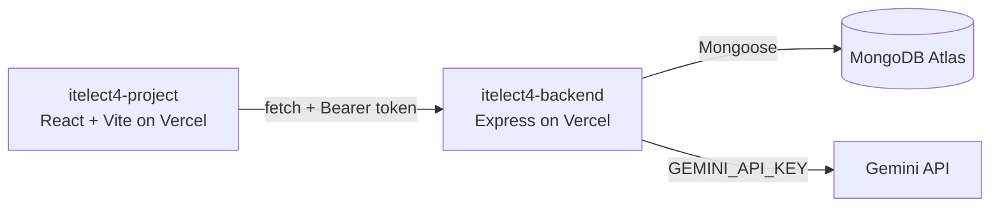

# Peer Tutoring Booking Platform

[](https://github.com/haziaintsht/itelect4-project/actions/workflows/ci.yml)

A simple semester-ready web app for connecting tutors and tutees through session
requests, booking statuses, and tutor profiles. The project demonstrates a
list-to-detail experience, role-based users, a multi-step booking lifecycle, a
live activity counter, and an AI Study Planner powered by Google Gemini.

- **Live site:** https://itelect4-project-sigma.vercel.app
- **Backend repo:** [itelect4-backend](https://github.com/haziaintsht/itelect4-backend)

## Architecture



## Project Highlights
- **Core Entities**: `User`, `Session`, and `Booking`
- **Roles**: `tutor` and `tutee`, each with its own screens after login:
  - **Tutee**: Bookings (request a session, follow its status) and the Study Planner
  - **Tutor**: Requests (confirm, decline, mark completed) and My sessions (create the sessions you teach)
  - `RoleRoute` sends a logged-in user with the wrong role back to the dashboard
- **Booking Lifecycle**: `requested -> confirmed -> completed`
- **Real accounts**: register and log in with email + password; the backend signs a JWT
- **Live Feature**: automatic activity counter updates
- **AI Study Planner** (`/study-plan`, login required): describe what you are stuck on and
  Gemini returns a summary, 1–3 focus topics, a level (`beginner` / `intermediate` /
  `advanced`) and a suggested subject that opens the matching sessions. The browser only
  talks to the backend's `POST /api/ai`; the Gemini key never leaves the server.

## Tech Stack
- React 19 · React Router 8 (SPA routing)
- TanStack Query (React Query) — data fetching + caching
- Zustand (with `persist`) — auth + UI state, saved to localStorage
- Vite (dev server + bundler) · Tailwind CSS
- React Hook Form + Zod (`@hookform/resolvers`) — form values + validation
- Shadcn UI (Base UI + Nova preset) — Button, Input, Label and Textarea, owned in `src/components/ui/`
- **API**: [itelect4-backend](https://github.com/haziaintsht/itelect4-backend) — Express + MongoDB + JWT.
  Every call to it lives in `src/api/client.ts`.

> The booking form's rules live in `src/schemas/bookingSchema.ts` (Zod), the
> form type is derived with `z.infer`, and the schema is wired into the form
> with `zodResolver`. Invalid submissions never reach the API. The Study
> Planner does the same with `src/schemas/studyPlanSchema.ts` (20–2000
> characters, the same limits the backend enforces).

## Installation

```bash
npm install
```

## Running the App

**Two servers must run at the same time** — keep both terminals open while you work.

### Terminal 1 — the API (itelect4-backend)
```bash
cd ../itelect4-backend
npm run dev
# API on http://localhost:4000
```

### Terminal 2 — the app (Vite + HMR)
```bash
npm run dev
# open http://localhost:3000
```

The app calls `http://localhost:4000` unless `VITE_API_URL` says otherwise
(copy `.env.example` to `.env` to change it). The backend's `CORS_ORIGIN` must be
`http://localhost:3000` for the browser to accept its replies.

## Build
```bash
npm run build      # must finish with ZERO TypeScript errors
```

## Testing and CI

```bash
npm test             # run every test once
npm run test:watch   # re-run tests as files change
npm run lint         # ESLint
```

The tests use Vitest, jsdom and React Testing Library, and they never reach the real API.

| File | What it checks |
| --- | --- |
| `src/components/SessionCard.test.tsx` | What a session card shows for its props, including a missing tutor |
| `src/hooks/useToggle.test.ts`, `src/hooks/usePrevious.test.ts` | State changes in the custom hooks |
| `src/pages/LoginPage.test.tsx` | Log in stays disabled until the form is filled, nothing is sent while it is incomplete, and API errors are shown |
| `src/pages/StudyPlanPage.test.tsx` | The schema blocks a short prompt before any request, and every field of a reply is shown |

GitHub Actions (`.github/workflows/ci.yml`) runs `npm ci`, `npm run lint`, `npm test` and `npm run build`
on every push.

## Deploy (Vercel)

Deploy the backend first — this app needs its address.

1. Push to GitHub. On vercel.com: **Add New → Project → Import** `itelect4-project`. Preset **Vite**.
2. Environment Variable: `VITE_API_URL` = `https://<backend>.vercel.app` (no trailing slash).
   Vite bakes it in at build time, so changing it later needs a redeploy.
3. Deploy, then copy this site's address into the **backend's** `CORS_ORIGIN` and redeploy the backend.

`vercel.json` sends every path to `index.html`, so refreshing `/bookings` or
`/sessions/:id` loads the app instead of a Vercel 404.

## AI Disclosure

- **In the app:** the Study Planner sends the text a student types to Google Gemini through the
  backend. Its replies are AI-generated and can be wrong, and the page says so.
- **In development:** Claude Code, an AI coding assistant, was used to help write, test and document
  this project, including the Study Planner, the tutor interface, the automated tests and the CI
  setup. I directed the work and am responsible for what is submitted.
